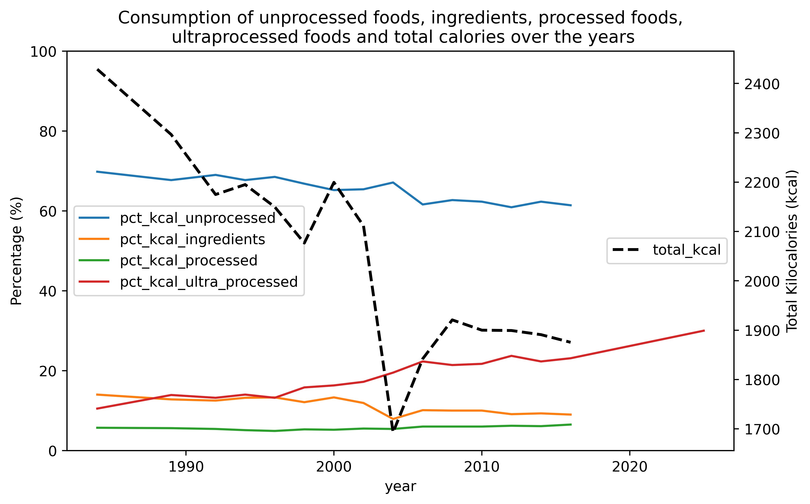
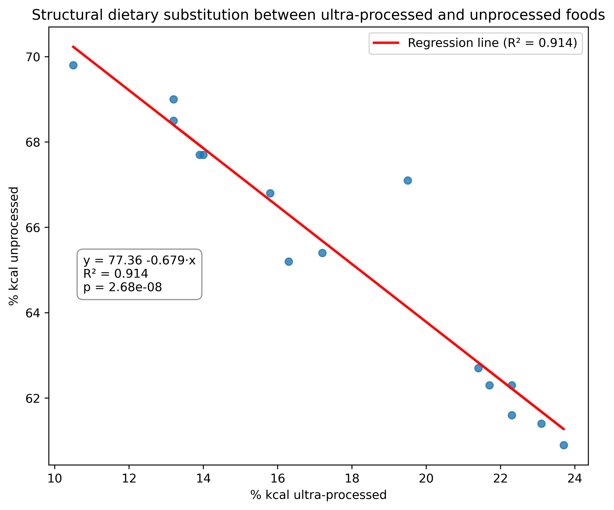
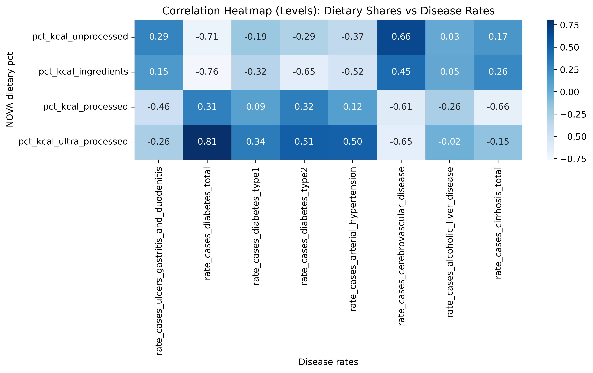
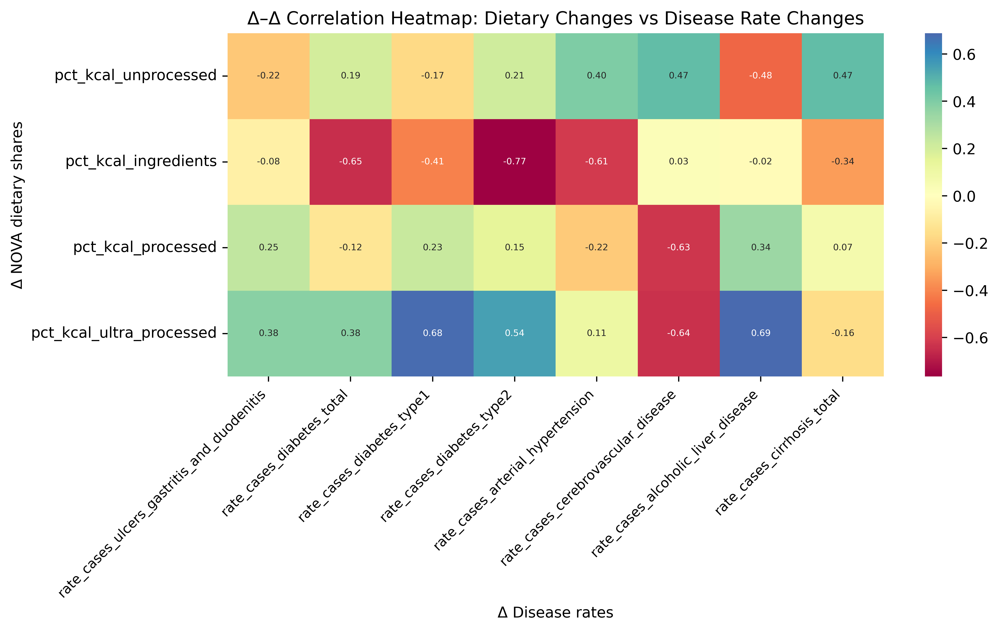
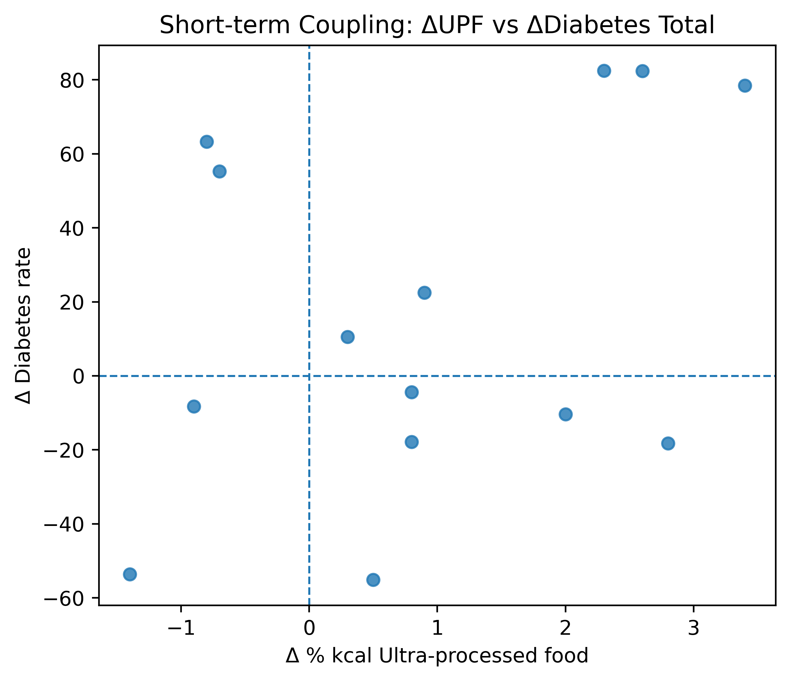
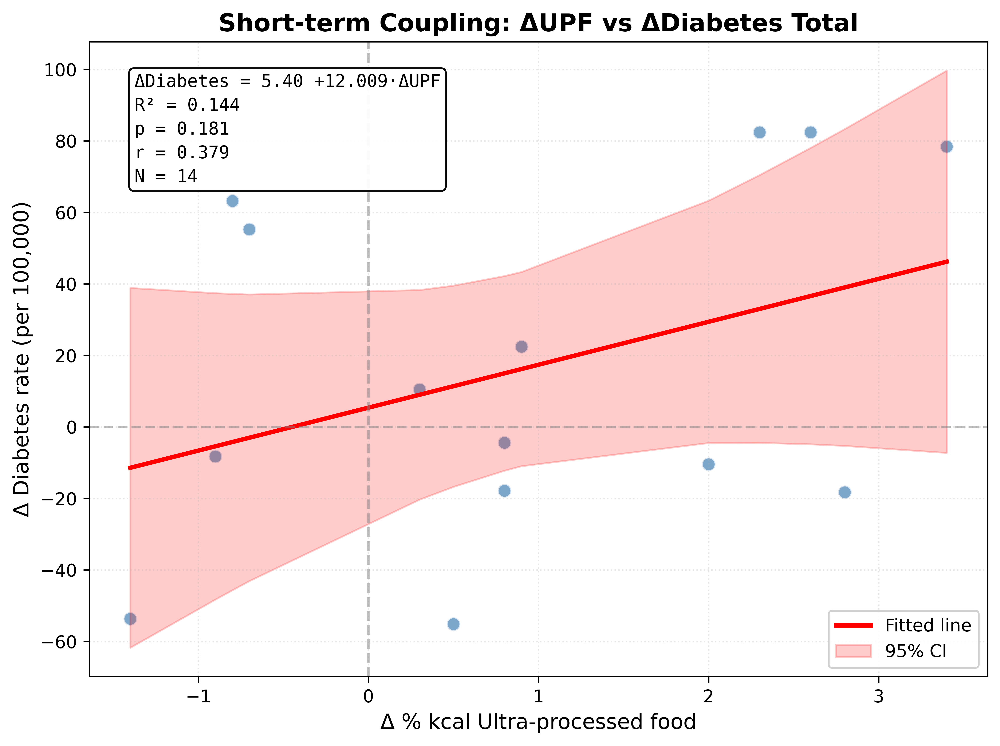
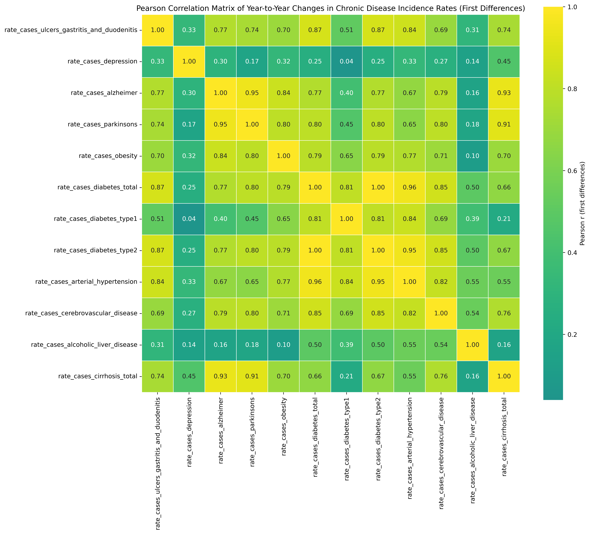
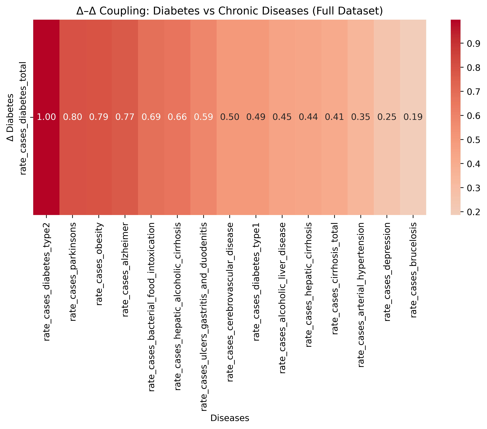

# Ecological Time-Series & Dietary Shift Analysis: NOVA Food Groups and Chronic Disease Rates in Mexico (1984–2024)

## Overview
This repository presents a newly constructed, multi-decade epidemiological and nutritional dataset alongside an ecological time-series analysis exploring ultra-processed food (UPF) consumption, NOVA dietary shares, population-adjusted disease incidence rates, and chronic/metabolic health indicators in Mexico.

Built from the ground up from primary official government publications, public health yearbooks, and dietary survey series, the dataset bridges four decades of surveillance records with irregular year intervals that reflect original source availability rather than missingness. Detailed manuscript modeling and full inferential tables are withheld pending formal release, while this repository documents the data engineering pipeline, core descriptive metrics, and exploratory coupling diagnostics.

## Key Numbers & Dataset Scope
- **Datasets & Time Coverage:** Covers **41 morbidity years (1984–2024)** across **20 disease/condition series**, **42 population years (1984–2025)**, and **16 NOVA dietary data points** (`1984, 1989, 1992, 1994, 1996, 1998, 2000, 2002, 2004, 2006, 2008, 2010, 2012, 2014, 2016, and 2025`).
- **Merged Ecological Sample (`1984–2016`):** Aligns **15 observation years**, yielding **$15 - 1 = 14$** step-to-step first-difference intervals ($N = 14$).
- **Ultra-Processed Food (UPF) Shift:** UPF share rose by **+12.6 percentage points** across the merged window ($23.1\% - 10.5\% = +12.6\text{ pp}$ from 1984 to 2016), and by **+19.5 percentage points** overall to **30.0%** in the 2025 NOVA series ($30.0\% - 10.5\% = +19.5\text{ pp}$, or $+6.9\text{ pp}$ from 2016 to 2025).
- **Total Diabetes Incidence Rate (`1984–2016`):** Increased from **73.13** to **300.08 per 100,000**—a net gain of **+226.94 cases per 100,000** (**+310.3%**)—and peaked at **397.90 per 100,000** in 2004 (**+324.77 cases per 100,000**, or **+444.1%** above 1984).
- **Levels vs. First Differences ($\Delta-\Delta$):** UPF share and total diabetes incidence correlate strongly in **levels** ($r = 0.81$), while step-to-step changes ($\Delta-\Delta$, $N = 14$) moderate to **$r = 0.38$** ($r = 0.379$, $R^2 = 0.3794^2 = 0.144$, $p = 0.181$, OLS slope $= +12.009$ cases per 100,000 per $+1\text{ pp}$ $\Delta\text{UPF}$).

## What This Analysis Covers
- **Data Compilation & Normalization:** Merging multi-year morbidity/disease records, population denominators, and NOVA dietary share series (`pct_kcal_unprocessed`, `pct_kcal_ingredients`, `pct_kcal_processed`, `pct_kcal_ultra_processed`, and total kilocalories) into rates per 100,000 population.
- **Long-Term Trends vs. Short-Term Coupling:** Comparing correlations in **levels** (capturing long-run secular trajectories) against **first differences ($\Delta-\Delta$)** (capturing step-to-step changes across available survey/reporting waves).
- **Diagnostic & Time-Series Exploration:** Evaluating stationarity, regression fits with confidence intervals, correlation heatmaps, and cross-disease coupling patterns.

## Visual Highlights

### 1. NOVA Dietary Shifts & Total Energy Over Time
Tracks the long-term rise in ultra-processed food caloric share alongside shifts across unprocessed foods, culinary ingredients, processed foods, and total kilocalories.

### 2. Levels vs. Short-Term ($\Delta-\Delta$) Diet–Disease Relationships
Contrasts long-run correlations in **levels** against step-to-step correlations in **first differences ($\Delta-\Delta$)** across NOVA dietary shares and disease incidence rates.

### 3. Short-Term Coupling & Cross-Disease Co-Movement
Examines OLS linear coupling with a 95% confidence band ($N = 14$, $r = 0.379$, $R^2 = 0.144$, $p = 0.181$) between $\Delta\text{UPF}$ and $\Delta\text{Diabetes Total}$ alongside inter-disease correlations in first differences.

## Repository Structure
- `starting_dbs/` — Core compiled input datasets (`diseases_1984_2024.csv`, `population_mexico_1984_2024.csv`, `nova_1984_2024.csv`).
- `notebooks/` — Exploratory and analytical Jupyter notebooks covering rate calculation, NOVA trends, and coupling analysis.
- `results/` & `old_results/` — Generated summary tables, merged analytical datasets (`merged_ecological_set_eco2.csv`, `nova_clean_eco2.csv`, `disease_with_rates_eco2.csv`), and exported `.png` figures.
- `muertes_inegi/` — Supplementary mortality/INEGI reference files.

## Key Analytical Notes & Limitations
- **Ecological Design:** Aggregate population-level associations describe macro-level patterns over time and do not establish individual-level causality.
- **Irregular Survey Intervals & Reporting Eras:** Because underlying government PDFs and dietary waves occur at uneven intervals (e.g., 5-year `1984–1989`, 3-year `1989–1992`, and mostly 2-year intervals thereafter) and specific conditions/subtypes begin in different years, pairwise sample sizes vary by series and should be interpreted alongside exact year coverage.

## Tools & Stack
- Python (`pandas`, `numpy`, `scipy`, `statsmodels`, `matplotlib`, `seaborn`)
- Jupyter Notebooks
